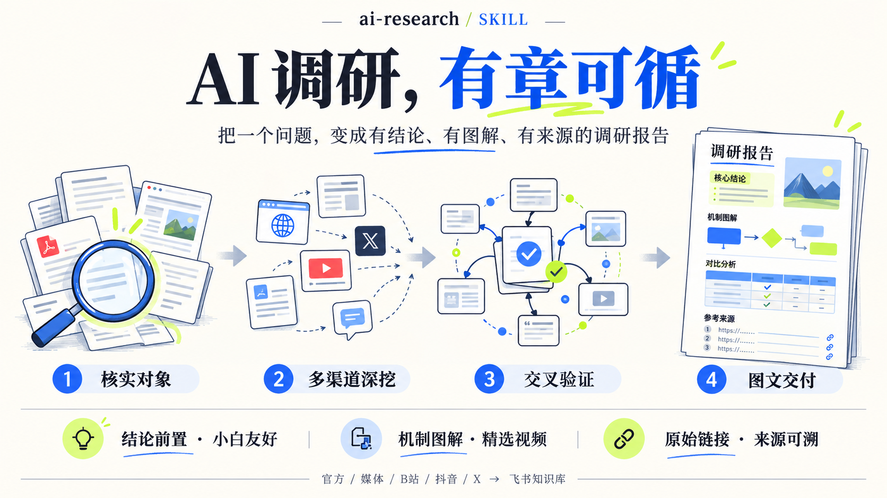
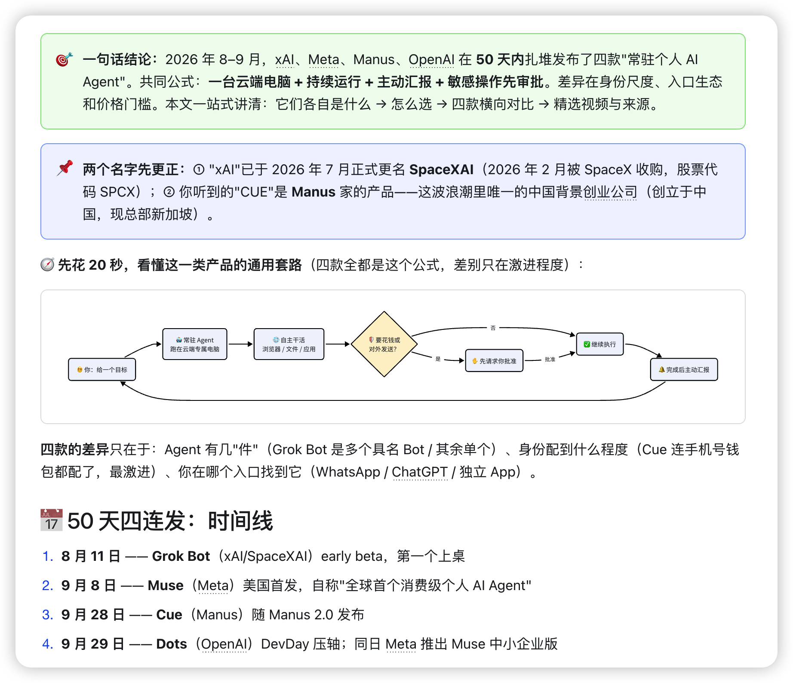
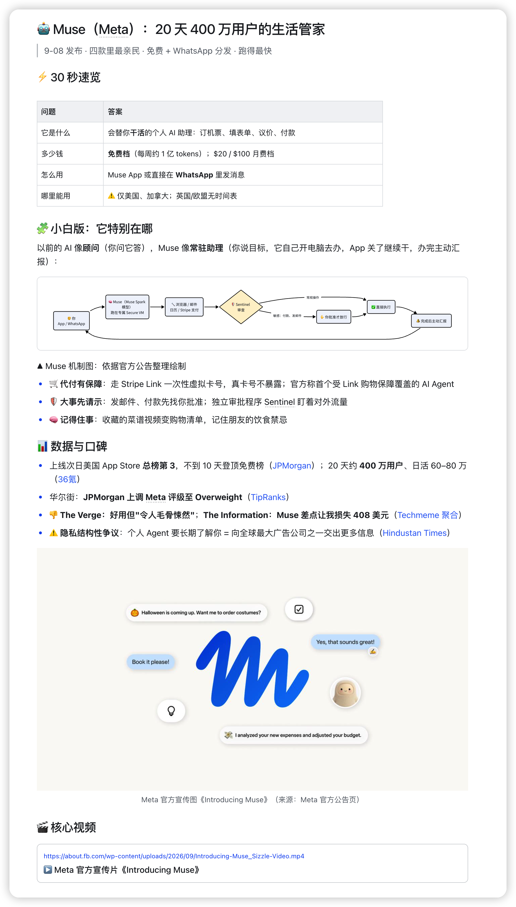
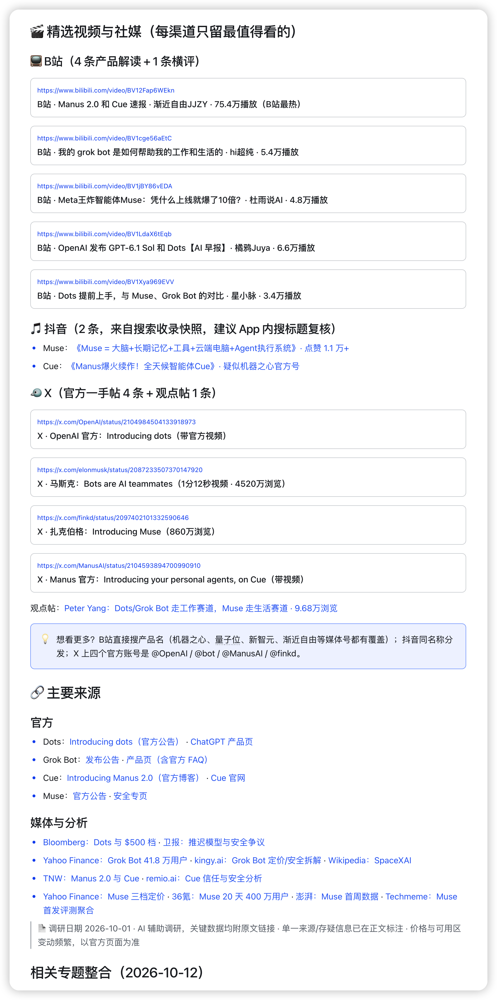

# ai-research



给 AI 编码代理使用的调研 Skill。把产品、竞品、技术和行业问题，整理成**小白能懂、重点突出、图文并茂、来源可溯**的调研报告。

## 你会得到什么

| 能力 | 交付效果 |
| --- | --- |
| 结论前置 | 一句话结论 + 30 秒速览表，先抓重点，再看细节 |
| 多渠道调研 | 官方公告、权威媒体，以及 B站 / 抖音 / X 的精选内容 |
| 交叉验证 | 核对关键事实，对单一来源、二手转述和冲突信息标注存疑 |
| 图文解释 | 自绘机制图、流程图、横向对比，辅以官方图片与视频卡片 |
| 来源可溯 | 关键事实附原始链接，文末按官方、媒体、社媒整理来源 |
| 知识沉淀 | 将报告写入飞书知识库，并检查章节和图片是否完整 |

## 效果展示

以下为用户提供的调研报告截图，展示排版与交付形式；截图中的产品信息、日期和数据保留原样，仅作效果示例，不代表本仓库对相关事实的核验或实时更新。

### 01 · 先给结论，再用机制图讲清楚

高亮结论、概念澄清、工作流程和时间线，让读者快速建立整体认识。



### 02 · 从速览到详解，兼顾理解与判断

以速览表回答核心问题，再展开机制、数据与口碑，配合图片和视频入口。



### 03 · 精选视频与来源，方便继续追溯

按渠道组织视频和社媒内容，集中列出来源，并标注访问与验证限制。



## 这是什么

给 AI 编码代理（ZCode / Claude Code 等）用的调研方法论 skill，定义了七步流程：

核实对象 → 拆解维度 → 并行深挖 → 交叉验证与存疑 → 产出文档（飞书知识库）→ 结构验证 → 可选收尾

以及产出标准：结论前置、小白友好、图文并茂（自绘 mermaid/SVG 图）、来源可溯（每条事实带原始 URL）。

## 安装

先克隆仓库，再将 Skill 复制到代理的技能目录：

```bash
git clone https://github.com/zhaoxinfeng619-hub/ai-research.git
cd ai-research
mkdir -p ~/.agents/skills/ai-research
cp SKILL.md ~/.agents/skills/ai-research/SKILL.md
```

如需按完整流程写入飞书知识库，需要安装并授权 `lark-cli`，并将 [SKILL.md](SKILL.md) 中的知识库空间与节点配置替换为你自己的目标位置。

## 使用

在支持 SKILL.md 的代理里说「用我的调研 skill 调研 XXX」即可。

例如：

> 用我的调研 skill，调研几款 AI 产品的定位、功能、价格与差异，给出怎么选的建议。

> 快速调研某项 AI 技术：优先官方来源，给我一句话结论和核心速览。

默认采用完整流程；说「快速调研」时，只查官方来源并输出核心骨架，可省略自绘图与视频。
